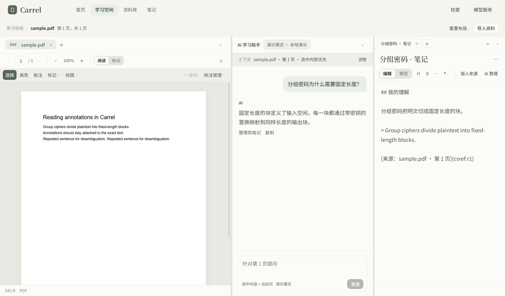

# Carrel

面向大学生自主学习的桌面端 AI 学习工作空间：课件阅读、带出处核验的问答、可回溯的个人笔记，在同一张三栏界面里。



## 特性

1. **阅读**：PDF、Markdown、图片导入后直接读——PDF 页面连续排布，滚动即翻页；缩放、页内查找、选中文本；高亮与批注按归一化坐标保存，窗口缩放后仍贴着原文。
2. **可核实的问答**：回答必须带 `@cite 页码 | 原文摘录`。应用逐字核对已提取的页面文本，通过才显示为可点来源，点击跳回该页并高亮原文；核对不通过标为「未核实」。
3. **回得去的笔记**：摘录和 AI 回答写进笔记时带 `csref` 来源锚点，点锚点回到对应文件与页码；选中片段可用「AI 整理」改写，只覆盖选区。

## 快速开始

**环境**：Node 22 以上、npm 10 以上；Windows 或 macOS。

**安装**：

```bash
cd app
npm install
```

**运行**：开发模式（Vite + Electron）：

```bash
npm run dev
```

生产模式：

```bash
npm run build && npm start
```

**预期输出**：Electron 窗口打开，首页显示问候语和最近资料，顶部导航在首页 / 学习空间 / 资料库 / 笔记之间切换。终端只打印 Vite 的地址，界面在 Electron 窗口里，不在浏览器中打开。

## 最小示例

1. 右上角「导入资料」选一份 PDF，进入学习空间。
2. 在左侧选中一段文字，中间输入框会显示「针对第 N 页提问」，发送。
3. 回答末尾带一行来源：

   ```text
   @cite 1 | Group ciphers divide plaintext into fixed-length blocks.
   ```

   这一行会被逐字核对；通过后变成可点的来源，点击回到该页并闪烁原文。
4. 回答下方点「整理到笔记」，摘录连同 `csref` 锚点写进右侧笔记；点锚点回到原文。

模块划分、请求链路与构建配置见 [app/README.md](app/README.md)。
